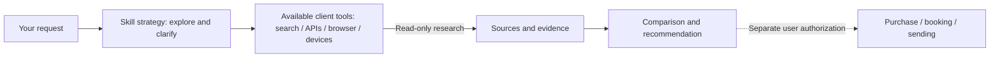

<div align="center">

# BaoDaTing · 包打听

**Ask BaoDaTing first.**

One request. Find sources, check evidence, compare options.

[中文](README.md) · [Install](docs/installation.md) · [Architecture](docs/architecture.md) · [Extend](docs/extensions.md)

</div>

BaoDaTing is a retrieval and research skill built on the [Agent Skills standard](https://agentskills.io/specification). It helps agents such as Claude Code, Codex, and Pi start with one request, discover existing solutions, verify important claims, and recommend options based on your needs and total cost.

Use it to find software, plugins, and open-source projects; compare products; research travel and dining; or explore academic literature.

> I need a way to organize scattered web pages and papers. Help me explore the options first.

## Get started

Run one command for your client from the project where you want to use the skill. Requires **Node.js 22.20+** and an installed agent client.

```sh
# Claude Code
npx skills add RUIIIOVO/BaoDaTing --skill baodating -a claude-code

# Codex
npx skills add RUIIIOVO/BaoDaTing --skill baodating -a codex

# Pi
npx skills add RUIIIOVO/BaoDaTing --skill baodating -a pi
```

Installation applies to the current project by default; add `-g` to use it across your projects. The `skills` command is [Vercel's installer](https://github.com/vercel-labs/skills), which fetches this skill from GitHub.

Start your client and describe what you need, or invoke the skill explicitly:

| Claude Code | Codex | Pi |
| --- | --- | --- |
| `/baodating Help me choose a reference manager` | `$baodating Help me choose a reference manager` | `/skill:baodating Help me choose a reference manager` |

Your agent needs search or source-reading tools. Installing the skill does not install MCP servers, connect devices, or sign in to accounts. See the [installation guide](docs/installation.md) for manual setup, temporary loading in Pi, and optional channels.

## How it helps you choose

1. **Find what exists.** Run an actual exploratory search and offer 2–4 directions supported by sources.
2. **Ask what changes the decision.** Move from broad goals to details, one consequential question per round. Skip settled questions.
3. **Verify original sources.** Check capabilities, prices, limitations, and experience reports. Explain commercial ties, conflicting evidence, and unknowns.
4. **Compare the full cost.** Check essential needs first, then fees, setup, maintenance, and migration. Explain what extra spending buys.

Recommendations include sources, applicable conditions, and gaps in coverage. Trying first, keeping your current tools, or deferring a purchase are valid outcomes. For academic work, methods and evidence strength come first; costs inform access and reproducibility.



## Channels and extensions

The skill carries the research method; your client's connected tools perform searches and actions. Choose channels for the task and explain coverage when a channel is unavailable.

| Sources you need | Optional channels |
| --- | --- |
| Web pages, docs, and code | Search, official APIs, `gh`, a dedicated research browser |
| macOS app content | [codex-computer-use](https://github.com/RUIIIOVO/codex-computer-use), with the official OpenAI runtime and OS permissions |
| Android app content | Mobile MCP, a dedicated device, and ADB; elements first, screenshots for gaps |

The repository includes optional browser and mobile launch scripts; see [channel setup](docs/installation.md#可选渠道). The research browser uses a separate persistent profile. Keep account state, credentials, preferences, and research records outside the repository.

**Add a plugin or source:** connect an existing tool, MCP server, or CLI to your client, then document when to use it, how to query it, what it can read, and its limits. See the [extension guide](docs/extensions.md).

## Read more

The detailed guides below are in Chinese; commands and paths apply to all clients listed above.

- [Architecture](docs/architecture.md): responsibilities and data flow across strategy, execution, and evidence.
- [Installation](docs/installation.md): three clients, standard directories, and optional MCP setup.
- [Extensions](docs/extensions.md): reuse existing tools and document new channels.
- [Validation record](docs/validation.md): specific environments, executed checks, and capabilities awaiting validation.

## Cost and license

Open source under [MIT](LICENSE), with no usage fee from BaoDaTing itself. Model calls, third-party APIs, subscriptions, and devices may incur separate costs depending on the services used.
