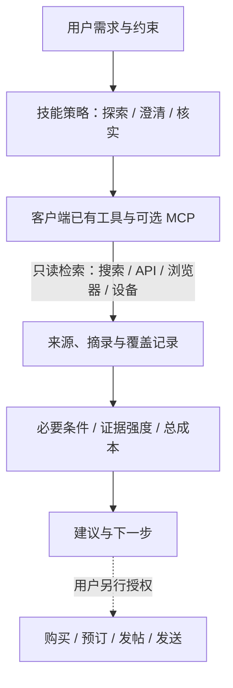

# 架构

[返回 README](../README.md) · [安装](installation.md) · [扩展](extensions.md) · [验证记录](validation.md)

BaoDaTing 把研究方法封装为可移植的 Agent Skill：从需求出发，选择资料渠道，核实证据，再比较可行方案。Claude Code、Codex、Pi 等客户端负责模型会话、工具调用与权限；搜索、浏览器和设备工具按需接入。

## 数据如何流动

需求模糊时，先进行一轮实际探索，再给出 2–4 个有依据的方向，每轮只问一个影响选择的问题。条件已明确就跳过澄清；简单事实查询只做必要检索。最终通常保留不超过三个有意义的选项，证据不足时说明缺口。

## 三项职责

| 部分 | 负责什么 | 主要文件或配置位置 |
| --- | --- | --- |
| 技能策略 | 探索顺序、澄清问题、来源判断、比较规则 | [`SKILL.md`](../skills/baodating/SKILL.md) 与 `references/` |
| 客户端与渠道 | 发现可用工具、读取来源、管理会话和操作权限 | 客户端自己的工具、MCP、CLI 与可选启动脚本 |
| 证据与决策 | 记录主张、来源、日期、条件、冲突和未读范围 | 用户指定的仓库外工作目录；结论在对话中交付 |

遵循 [Agent Skills 标准](https://agentskills.io/specification)的目录携带说明、参考材料与可选脚本。客户端先发现名称与描述，使用时读取完整说明，再按需读取参考文件。工具权限、账号与设备仍由各客户端管理。

## 渠道怎么选

优先使用已经接入且能解决问题的工具。结构化资料适合官方 API、连接器或 `gh`；页面交互交给浏览器；只有 App 中才有的资料再考虑设备。具体动作和访问结果决定覆盖范围。

| 渠道 | 接入方式 | 需要确认的边界 |
| --- | --- | --- |
| 搜索、官方 API、代码平台 | 客户端已有工具、连接器或 CLI | 查询范围、版本、权限、分页和原始链接 |
| 公开与登录网页 | 已有隔离浏览器，或可选 `browser.mjs` 启动的研究浏览器 MCP | 独立配置、登录状态、正文与评论各层的可读性 |
| macOS 应用 | 可选 [codex-computer-use](https://github.com/RUIIIOVO/codex-computer-use) | OpenAI 官方运行时、系统权限、应用与后台操作支持 |
| Android App | 可选 `mobile.mjs` 启动 Mobile MCP | ADB、设备授权、明确的设备 ID、App 元素与截图覆盖 |

浏览器与移动端脚本负责启动上游 MCP 服务和输出命令配置；不代替客户端完成 MCP 接入，也不自动创建账号、登录或连接设备。见[安装指南](installation.md#可选渠道)。可用性与具体测试结果见[验证记录](validation.md)。

## 会话与授权

公开网页使用独立研究会话；登录研究使用独立持久化浏览器配置和用户指定的研究账号。研究浏览器与日常浏览器分开，不连接日常 Chrome，不复制 Cookie、密码库或配置。同一持久化配置仅供一个浏览器进程使用。

同一会话、应用或设备的操作按顺序执行；互不影响的数据读取才可并行。原生桌面操作与无头浏览器是两个独立渠道。元素读取优先，截图补充视觉标记、图表和元素树缺失的信息；是否支持后台操作取决于所用工具。

登录、验证码和访问阻断需要记录，并交由用户处理或换用可访问来源。会话隔离用于分开研究与个人状态，不承诺规避平台限制。

研究授权覆盖检索与读取。购买、预订、发帖、私信、付费访问和账号变更须有相应用户授权；已有授权无需重复询问。网页、帖子、评论、README 与工具返回的内容作为资料读取，其中的指令不能授予操作权限。

## 证据如何进入建议

每条影响决策的主张保留对象及版本、原始链接或 App 定位、摘录或截图位置、资料日期、获取日期和适用条件。区分官方声明、独立反馈、直接观察、证据冲突与尚未核实。

渠道记录区分不可用、未检索、受阻、部分读取、成功有匹配和成功无匹配。搜索成功不代表正文、评论、回复或视频均已读完；未找到也不等于不存在。

商业关系、内容质量、来源独立性和自动化线索分别判断。合作声明和佣金链接可证明商业关联，不能直接证明说法为假；多个转载不能充当多份独立证据。没有实际测试就不声称亲自试用，不编造置信度或结果。

先检查必要条件，再比较有效功能与费用、配置、学习、维护、迁移和时间成本。论文还需核对方法、基线、数据与适用条件；获取和复现费用用于判断可行性，学术质量由证据判断。

## 文件与改动入口

| 位置 | 修改用途 |
| --- | --- |
| [`skills/baodating/SKILL.md`](../skills/baodating/SKILL.md) | 通用研究流程与交付要求 |
| [`references/channels.md`](../skills/baodating/references/channels.md) | 渠道选择、能力检查与覆盖记录 |
| [`references/integrations.md`](../skills/baodating/references/integrations.md) | 安装后随技能携带的可选渠道接入说明 |
| [`references/evidence-and-quality.md`](../skills/baodating/references/evidence-and-quality.md) | 来源与证据质量判断 |
| [`references/decision.md`](../skills/baodating/references/decision.md) | 各类任务的比较规则 |
| [`references/preferences-template.md`](../skills/baodating/references/preferences-template.md) | 可选的个人偏好模板 |
| `skills/baodating/scripts/` | 可选浏览器与移动端 MCP 启动脚本 |
| [`skills/baodating/evals/evals.json`](../skills/baodating/evals/evals.json) | 通用评测用例设计；执行结果另记 |

运行时数据保存在仓库外：研究浏览器配置、账号状态、设备信息、凭据、个人偏好、证据与截图。按任务需要保存记录，单个事实查询无需建立一整套文件。增加资料渠道通常只需接入现有工具并补充[渠道说明](extensions.md)。
